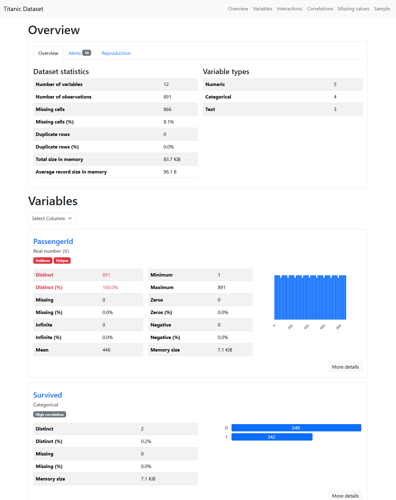
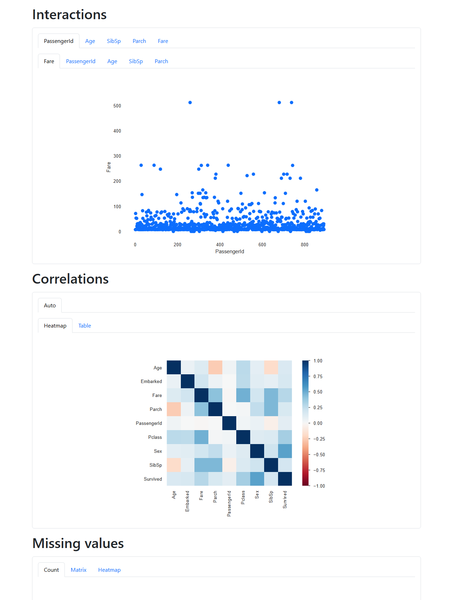

# lean-profiling

ydata-profiling's HTML report and `profiling.json`, rebuilt on **pandas and numpy only**.

ydata-profiling 4.18 installs 55 packages: scipy, statsmodels, numba and llvmlite, matplotlib, seaborn,
phik, wordcloud, requests and more. Each one is something to patch when a CVE lands. It also imports
`pkg_resources`, which setuptools removed in 82.0.0, and ydata-profiling itself no longer gets updates.

lean-profiling installs pandas and what pandas needs, and nothing else:

```
pandas, numpy, python-dateutil, pytz, six, tzdata
```

That's with pandas 2. pandas 3 no longer needs `pytz`, so it's five packages. Both are supported and tested;
ydata-profiling itself pins `pandas<3`.

## Usage

The API matches ydata-profiling's `ProfileReport`, so switching is a one-line import change:

```python
import pandas as pd
from lean_profiling import ProfileReport  # was: from ydata_profiling import ProfileReport

report = ProfileReport(pd.read_csv("training.csv"), title="Training data")
report.to_file("profiling.json")
report.to_file("report.html")
```

`to_json()`, `to_html()`, `get_description()`, `get_duplicates()`, `get_rejected_variables()` and
`minimal=True` work as in ydata-profiling. Settings are keyword arguments, using nested dicts for nested
sections, e.g. `ProfileReport(df, plot={"histogram": {"bins": 20}}, samples={"head": 5})`.

## Example: Titanic

[`examples/titanic`](examples/titanic) profiles Kaggle's Titanic passenger list (891 rows, 12 columns):

- [`report.html`](examples/titanic/report.html) is the report. [View it in the browser](https://htmlpreview.github.io/?https://github.com/rainbowpusheenthe3rd/lean-profiling/blob/main/examples/titanic/report.html), or download it and open it locally.
- [`profiling.json`](examples/titanic/profiling.json) is the JSON description.
- [`generate.py`](examples/titanic/generate.py) is the script that made them:
  `python examples/titanic/generate.py`.

An excerpt of the generated `profiling.json`, cut down to a few fields:

```json
{
    "table": {
        "n": 891,
        "n_var": 12,
        "n_cells_missing": 866,
        "p_cells_missing": 0.08099513655069211,
        "n_duplicates": 0,
        "types": {
            "Numeric": 5,
            "Categorical": 4,
            "Text": 3
        }
    },
    "variables": {
        "Age": {
            "type": "Numeric",
            "n": 891,
            "count": 714,
            "n_missing": 177,
            "p_missing": 0.19865319865319866,
            "n_distinct": 88,
            "mean": 29.69911764705882,
            "std": 14.526497332334042,
            "min": 0.42,
            "5%": 4.0,
            "25%": 20.125,
            "50%": 28.0,
            "75%": 38.0,
            "95%": 56.0,
            "max": 80.0,
            "skewness": 0.38910778230082693,
            "kurtosis": 0.1782741536421022,
            "n_zeros": 0,
            "monotonic": 0
        }
    },
    "alerts": [
        "[Sex] is highly overall correlated with [Survived]",
        "[Survived] is highly overall correlated with [Sex]",
        "[Age] 177 (19.9%) missing values",
        "[Cabin] 687 (77.1%) missing values"
    ]
}
```

The full file has the same top-level keys as ydata-profiling's: `analysis`, `table`, `variables` (every
statistic per column, including value counts and histograms), `correlations`, `alerts`, `sample`,
`duplicates`, and the chart SVGs under `scatter` and `missing`. The charts make up most of its 1.4 MB,
which is too large for GitHub to preview, so open it with **Raw**.





## How close is it?

On three test datasets (Titanic, a synthetic training table and a set of edge cases), the statistics are
identical to ydata-profiling 4.18.4: every field of `table`,
`variables`, `correlations`, `alerts`, `duplicates` and `sample` in `profiling.json` matches. That includes
the chi-square p-values, histograms, Spearman/Cramér's V correlations, Unicode summaries and type
inference. The JSON has the same keys in the same order.

The HTML uses ydata-profiling's own Bootstrap 5.3.3 theme, stylesheet and script with the same page
structure, so every section, tab and table renders the same. The charts are SVG drawn to matplotlib's
geometry (figure sizes, tick choices, number formats, colours and fonts), so histograms, category bars,
scatter and hexbin plots, the correlation matrix and the missing-value charts look the same.

Known differences:

- **Word clouds** use the same style (viridis colours, monospace font, nested placement) but a simpler
  layout, so word positions differ. ydata-profiling's word positions are random too.
- **Ambiguous text columns.** ydata-profiling picks between types in an order that changes between runs.
  For example, a text column with a few repeated dates can come out as DateTime one run and Categorical the
  next. lean-profiling always tries Boolean, Numeric, DateTime, then Categorical.
- **Branding.** The footer, version link and the `package` key of the JSON name lean-profiling:
  `lean_profiling_version` and `lean_profiling_config` replace `ydata_profiling_version` and
  `ydata_profiling_config`.
- **Variable anchor IDs** are stable between runs. ydata-profiling's change every run.
- **The HTML is not minified**, so the file is larger, but it renders the same.
- **Speed.** It is about 20–30× faster on the test data (0.8 s against 16 s for 600 rows × 13 columns).

### Not supported

Only ydata-profiling's default report is implemented. These features are not:

- correlation methods other than `auto` (Pearson, Spearman, Kendall, phik and Cramér's V tables)
- time-series mode
- report comparison
- Spark
- file, image, URL and path types
- Jupyter widgets
- themes
- pie charts
- redaction
- non-inline assets

## Checking it on your data

`tools/compare_with_ydata.py` compares the JSON field by field against a `profiling.json` made by
ydata-profiling in a separate environment. The script's docstring gives the commands.

## Tests

```
python -m unittest discover tests
```

## Licence

MIT. Parts are ported from ydata-profiling (MIT), and the page assets come from ydata-profiling and
Bootstrap (MIT). See `LICENSE` and `THIRD_PARTY_NOTICES.md`.
